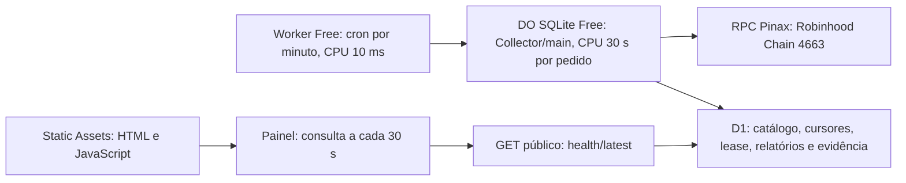

# Arquitetura e próximos passos

## Implementado agora

```text
RPC mainnet → descoberta e catálogo → leituras fixadas num bloco → snapshots parciais
  → identidade/idade → qualidade dos dados
  → segurança → filtros de potencial → score → confirmação
  → relatório + estado persistente + eventos locais
```

`src/engine.mjs` é um motor puro com relógio injetável. `src/runner.mjs` trata lotes, continuidade e transições. `src/cli.mjs` avalia ficheiros. `src/onchain/` liga a descoberta, metadados, provas de criação, estado das pools e swaps à avaliação dos dois pipelines. A CLI do collector publica um bundle atómico, com lock por diretório e arquivos de evidência por execução. `config/policies.json` guarda limiares; `config/collector.json` guarda orçamento, intervalos e deployments. `src/network.mjs` regista os identificadores e quote assets canónicos, com referências oficiais. O cliente RPC tem uma allowlist de métodos de leitura; não permite envio de transações.

A configuração usa mainnet **4663**, ETH para gas e quote assets WETH/USDG. Testnet **46630** serve para testes de adaptadores e não entra no universo de mercado, preços, retornos ou alertas reais. Estes metadados foram consultados na [documentação da rede](https://docs.robinhood.com/chain/connecting/) e nos [contratos oficiais](https://docs.robinhood.com/chain/contracts/) em 2026-10-19. A presença de um RPC no registry não significa que foi contactado ou que o serviço está saudável nesta entrega.

Na CLI manual, um crash pode deixar o ficheiro `.lock`; verificar o processo antes de o remover. O novo worker usa `flock`, libertado pelo kernel após interrupção, e systemd para reinício/boot. Corrupção do estado interrompe a execução em vez de inventar continuidade. Não misturar CLI manual e worker no mesmo diretório nem tratar workers independentes como um único canal de alertas.

## Recolha real e extensões pendentes

| Camada | Fontes candidatas, a validar | Requisito |
|---|---|---|
| Estado da rede | JSON-RPC Robinhood Chain e monitorização independente | Verificar `eth_chainId`, cabeça/bloco/hash, saúde do sequenciador e reorganizações |
| Descoberta de novos tokens | Factories/launchpads suportados e traces de criação via RPC/indexer EVM | Deployment real do contrato, pools, blocos e logs canónicos; reconciliar eventos removidos e reconexões |
| Universo estabelecido | Índice paginado de pools + lista curada de contratos | Revarrer o universo completo; não depender apenas de trending |
| Mercado | Swaps/reservas e histórico indexado das DEX verificadas; API externa só após confirmar cobertura | Preços USD verificáveis para WETH/USDG; deduplicar pools/trades e fixar janelas |
| Supply e holders | RPC/indexer EVM, com infraestrutura como Alchemy | Bytecode, `totalSupply`, balances, logs e permissões; nem todos os dados estão num único endpoint |
| Risco e LP | Código/bytecode no Blockscout + análise de contratos e posições LP | Seguir implementação/roles/proxy/locks e testar transferências, não usar só um rating agregado |
| Bundles, insiders e organicidade | Indexer histórico e heurísticas próprias versionadas | Não substituir dados indisponíveis por zero; registar cobertura e incerteza |
| Executabilidade | Routers verificados da rede + simulação EVM com estado encadeado/fork | Cotação não basta; simular entrada/saída sem enviar transações |

O caminho RPC para os deployments Uniswap v2/v3/v4 está implementado. As outras integrações da tabela são extensões a validar, sem garantia de que um fornecedor disponibilize todas as métricas. A [documentação oficial](https://docs.robinhood.com/chain/) lista infraestrutura e DEX do ecossistema; essa listagem não constitui auditoria. Os endereços usados na descoberta vêm do [registry oficial Uniswap](https://developers.uniswap.org/deployments.json). Não assumir suporte desta rede por ferramentas usadas noutras chains. O RPC público permite uma primeira recolha sem chave; histórico archive e uma cadência de produção podem exigir fornecedor dedicado. Ver [detalhes do collector](ONCHAIN.md).

Cadências alvo: novos a cada 60s, estabelecidos a cada 300s. O collector atual faz sessões sem sobreposição, alterna observações recentes e menos observadas e retoma o backfill. A cadência efetiva inclui o tempo da sessão e o intervalo configurado; o orçamento de enriquecimento não garante revisitar todos os tokens a cada minuto. Medir esta cobertura antes de ativar sinais reais. Aos 2–7 dias os tokens podem continuar no catálogo, mesmo fora da seleção dos dois pipelines.

O collector publica snapshots parciais identificados com os dados efetivamente observados e as lacunas. Só snapshots com todas as evidências exigidas pela política podem tornar-se candidatos. Histórico insuficiente continua incompleto. Falhas de fornecedor, rate limits e timeout não são risco zero nem uma lista sem oportunidades. Medir explicitamente cobertura por campo, atraso, erros e percentagem de tokens bloqueados/incompletos.

## Avaliação de mercado separada

`src/cloudflare/providers.mjs` renova as métricas das até 20 entradas numa chamada conjunta DEXScreener por minuto. O estado persistente de fornecedores tem teto de 32 KiB, TTL de 120 segundos para mercado e 300 segundos para GoPlus, com cooldown e backoff perante erros e rate limits. A renovação do mercado mantém as datas originais das análises de contrato e segurança.

`src/cloudflare/market-signals.mjs` aplica `config/market-signals.json` sem alterar `config/policies.json`. Os alertas `MARKET_ALERT` exigem filtros, score e confirmação próprios e mantêm `tradeApproved: false`; transações do fornecedor não são traders únicos, nem USD externos comprovam preços on-chain. A descoberta e a leitura de pools v4 admitem ETH nativo como moeda zero, distinto de WETH; os pares externos v4 usam IDs de 32 bytes.

O collector preserva confirmações estritas ainda válidas durante a rotação de contratos, com limites de idade e quantidade. O scanner CLI continua a tratar cada input como um lote completo. `src/cloudflare/public-report.mjs` revalida evidência e cabeça em cada leitura e publica separadamente `marketSignalsAvailable`/`signals.marketAlerts` e `currentSignalsAvailable`/`signals.tradeCandidates`. Dados expirados não mantêm um alerta atual durante uma falha de recolha.

## Persistência e jobs

O worker em `src/worker/` usa disco persistente na máquina Linux: arquivos gzip, fsync/rename atómico, lock do kernel e estado de saúde. Retoma catálogo/cursores, invalida confirmação após falha e preserva evidência referenciada na retenção. O limite de arquivo evita crescimento ilimitado; um orçamento ocupado por provas protegidas suspende a recolha. Ver [operação gratuita](FREE-HOSTING.md). A CLI conserva ficheiros separados para execução manual. O adaptador Vercel Blob da versão anterior foi retirado para cumprir o orçamento zero.

O adaptador principal em `src/cloudflare/` usa este fluxo:



O Worker chama `env.COLLECTOR.idFromName('main')` e encaminha um POST interno. A classe `Collector` executa `collectFree` com os mesmos bindings. D1 conserva o estado existente, transação, lease e fencing; o armazenamento SQLite interno do DO não recebe o catálogo. O Worker serve o painel e o script através de Static Assets, e os dados JSON em `/health` e `/latest`; um POST público não desencadeia recolha. O único objeto nomeado recebe cerca de 1.440 chamadas/dia, sem alarmes ou timers recorrentes de agendamento.

A recolha direta no Worker mediu cerca de 23–55 ms de CPU e excedia o limite Free de 10 ms. O DO tem um limite próprio de 30 segundos de CPU por pedido; a espera pelo DO não conta como CPU do Worker. A arquitetura passou 153 testes e dois ciclos locais com DO/RPC real. As primeiras amostras remotas após a mudança registaram p99 de 0,854 ms no cron do Worker e 3,227 ms num GET; a CPU/duração do DO e a estabilidade durante 24 horas continuam a exigir acompanhamento. O DO SQLite Free inclui 100.000 pedidos/dia, 13.000 GB-s de duração/dia e 5 GB de armazenamento por conta; o tempo de espera de rede também consome duração. Ao exceder quotas, reportar erro ou suspensão até ao reset, sem upgrade automático. Ver [configuração sem cartão e limites](FREE-HOSTING.md).

`wrangler.json` declara o binding DO e a primeira migration `new_sqlite_classes: ["Collector"]`. A primeira publicação e mudanças de migrations usam o deploy normal do helper. `versions upload`/`versions deploy` ficam disponíveis para alterações só de código depois da migration inicial aplicada.

Se o índice crescer além dos limites desta base ou forem necessários canais de alertas, avaliar armazenamento transacional para tokens, pools, observações, avaliações, jobs e outbox. Chaves incluem chain ID + ambiente + contrato normalizado; cada observação inclui event time, ingest time, bloco e hash. Guardar também a etapa de finalização, e reconciliar com L1 quando necessário. Alertas usam IDs únicos e outbox para evitar perdas/duplicação num retry.

Jobs fazem retry limitado com backoff/jitter e respeitam quotas por fornecedor; se a evidência ultrapassar o TTL, suspender candidatos e reportar degradação. Usar leases/locks duráveis por pipeline/partição e atualização transacional do estado. Definir circuit breaker para indisponibilidade generalizada. Não transportar a persistência de ficheiros para uma função Vercel como armazenamento durável.

## GitHub — preparação

Este diretório pode ser a raiz do novo repositório. Inclui `.gitignore`, lockfile do npm, testes e CI para Node 22/24. O diretório `runtime/` e quaisquer credenciais ficam fora do versionamento. Rever o nome/visibilidade do repositório e a licença antes de publicar. Não existe remoto configurado nesta entrega.

Sequência futura: criar o repositório, importar estes ficheiros, correr CI e abrir a primeira revisão dos parâmetros. Cada alteração de política deve ter motivo, versão e comparação histórica. Instalar as dependências do lockfile (`viem`, `undici`); não são necessárias credenciais de carteira. Snapshots v1 não são compatíveis com o contrato de dados v2. O CI usa RPC simulado e filesystem/processos locais; não faz recolha live nem provisiona servidores.

## Vercel Hobby e collector separado

A página deverá mostrar dois separadores, estado do worker, hora e expiração da evidência, candidatos, watchlist, tokens bloqueados e razões. Mostrar o score por componente, os limiares e a proveniência; não apenas uma seta de compra. Não apresentar um candidato expirado como atual. Não mostrar fixtures como oportunidades reais.

`public/index.html` e `public/dashboard.js` apresentam o painel no próprio Worker através do binding `ASSETS`. O browser consulta `/health` e `/latest` no mesmo domínio a cada 30 segundos enquanto está visível, sem lançar recolhas. A interface distingue a última consulta do browser da última recolha persistida, preserva os dados anteriores em caso de falha e mostra a perda de atualidade. Os endpoints JSON continuam disponíveis para integrações. O [espelho na Vercel Hobby](https://memecoin-radar-six.vercel.app) está publicado desde 23/10/2026 e encaminha os dois endpoints através de rewrites na mesma origem, com cache desativado. Ver [configuração publicada](VERCEL.md). Manter chaves fora do browser e não aceitar snapshots do utilizador como evidência de mercado.

A restrição atual é orçamento zero e sem cartão. O collector foi publicado em Workers Free + DO SQLite Free + D1 em 21/10/2026, com cron por minuto. A persistência foi verificada nos ciclos naturais do fluxo inicial anterior ao DO e nos ciclos locais com DO; as primeiras amostras remotas após a mudança estão registadas em [operação](OPERATIONS.md). Usa o RPC público Pinax, listado nos docs Robinhood. Tem âmbito menor que o Node: descoberta/metadados e avaliação parcial; reservas/swaps completos permanecem no worker Node. A evidência tem retenção de três horas e o catálogo é podado para 50.000 pools por dia de ciclos. Os pipelines continuam `INCOMPLETE` quando faltam provas. Ver [limites gratuitos](FREE-HOSTING.md). A página Vercel Hobby já está publicada e lê os resultados existentes; o cron e a persistência permanecem na Cloudflare. O worker Linux é uma alternativa para uma máquina já existente. Não foram comprados planos nem provisionados recursos pagos.

## Telegram — fase posterior

Enviar apenas eventos confirmados, não o stream completo. Mensagem proposta: pipeline, rede e chain ID, contrato, idade, liquidez, FDV, score/componentes, resumo de risco, etapa de finalização, data de avaliação, expiração e ligação ao detalhe. Escapar símbolos/texto externos, validar links e deduplicar pelo ID do evento.

Implementar opt-in de chat, cooldown, limites por canal, outbox persistente, retry e deduplicação por destinatário; não enviar dados sintéticos para um canal de sinais reais. Guardar `TELEGRAM_BOT_TOKEN` no servidor. Uma mudança de risco num candidato já publicado deve poder gerar atualização/revogação, não apenas um novo alerta positivo. Não há bot nem mensagens externas nesta versão.

## Execução financeira

Fora do âmbito desta base. Não há carteira, assinatura, aprovação de token ou compra/venda automática. Se esta fase for pedida no futuro, definir separadamente posição máxima, perda por operação/dia, concentração por criador, tolerância a custos, condições de saída e kill switch, depois de testar em paper trading. Não confundir montante da simulação com capital a investir.
