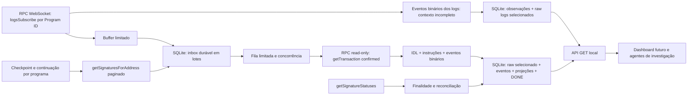

# Arquitetura — Solana Realtime Radar

Este pacote é um processo Node.js ESM independente do scanner Robinhood. Todos os módulos, dependências, testes, IDLs, documentação e runtime do novo scanner pertencem a `solana/`. O processo verifica o genesis hash Mainnet pelo RPC HTTP antes de arrancar a subscrição; não contém private keys, assinatura, envio de transações, estratégias ou integração LLM. A allowlist RPC exclui métodos financeiros.

A base de adaptação está em [ADAPTATION-AUDIT.md](ADAPTATION-AUDIT.md). A cobertura efetivamente comprovada por protocolo e as medições reais são apresentadas em [VALIDATION.md](VALIDATION.md), sem transformar os testes sintéticos em evidência Mainnet.

## Fluxo implementado

A WebSocket é o caminho principal de descoberta. Os timers locais descarregam buffers, alimentam filas, reconciliam finalidade e controlam retenção; não fazem polling de todos os tokens. A recuperação consulta histórico dos programas selecionados, com orçamento RPC partilhado com o fluxo live.

| Módulo | Responsabilidade |
| --- | --- |
| `src/config.mjs` | Variáveis de ambiente e limites validados; endpoints HTTP/WebSocket independentes. |
| `src/rpc.mjs` | JSON-RPC de leitura, genesis Mainnet, precisão de inteiros, timeout, concorrência, orçamento por minuto e retry limitado. |
| `src/websocket.mjs` | Uma ligação central e subscrições independentes, heartbeat, idle/ack timeout, reconnect exponencial com jitter e reconstrução das subscrições. |
| `src/queue.mjs` | Fila com capacidade e concorrência limitadas, drain e métricas. |
| `src/scanner.mjs` | Orquestração do ciclo de vida, ingress, enriquecimento, recuperação, reconciliação, segurança opcional e health. |
| `src/protocols/` | Registro dos Program IDs a partir dos IDLs versionados, Borsh, contexto top/inner e adaptadores de Pump/Raydium. |
| `src/events.mjs` | Esquema canónico e identidade determinística dos eventos enriquecidos. |
| `src/log-observations.mjs` | Observações rápidas dos eventos binários contidos nos logs RPC, sempre com contexto incompleto e identidade separada. |
| `src/store.mjs` | SQLite WAL, inbox, eventos, projeções, checkpoints, erros, lacunas, retenção e consumo de disco. |
| `src/market.mjs` | Agregados verificáveis por mint/quote/pool, janelas temporais e preços racionais. |
| `src/security.mjs` | Mint SPL/Token-2022, autoridades, extensões e relatório conservador de lacunas. |
| `src/api.mjs` | Interface HTTP GET para leitura; não altera filtros, políticas, scoring ou permissões. |
| `scripts/run.sh` | Exclusão por `flock` num lock exclusivo do novo scanner. |

## Transporte e controlo de carga

Cada `logsSubscribe` usa exatamente um endereço em `mentions`. O scanner não identifica programas pelo símbolo de um token ou pelo nome de uma aplicação. O registry associa Program ID e IDL; uma instrução não reconhecida gera diagnóstico, sem fabricar uma compra/venda a partir de palavras nos logs.

A ligação só fica pronta depois de todas as subscrições serem reconhecidas pelo RPC. O heartbeat usa ping/pong; ack timeout, inatividade, rejeição de subscrição, mensagens inválidas e falhas de transporte provocam desconexão e recuo. O atraso de reconexão cresce exponencialmente até ao teto configurado, com jitter. As subscrições são reconstruídas depois de cada ligação.

O ingress guarda até 1.000 observações em memória por omissão. O buffer descarrega no máximo 100 observações por transação SQLite, a cada 250 ms ou quando reúne 100 entradas. Antes desse commit existe uma pequena janela volátil: um crash pode perder observações do buffer; a recuperação histórica tenta cobri-la, dentro da retenção do RPC.

A inbox persistida permite reiniciar a fila sem perder o trabalho já confirmado em disco. O limite durável por omissão é 250 pendentes. Com as observações rápidas de logs ativadas (configuração por omissão), a WebSocket continua a recolher essas observações, mas novas assinaturas deixam de entrar na fila de enriquecimento HTTP quando esta está cheia; `contextEnrichmentSkipped` contabiliza esse desvio e `DURABLE_BACKPRESSURE` identifica a cobertura incompleta do contexto. As observações não enriquecidas continuam separadas de `/events` e `/market`. Se `SOLANA_LOG_OBSERVATIONS_ENABLED=false`, o modo só de enriquecimento interrompe a subscrição ao atingir o limite durável e reinicia abaixo de metade do limite. O overflow do ingress regista assinatura/slot/programa e força reconexão. Uma lacuna fica visível quando a história necessária já não puder ser obtida.

O cliente HTTP aplica um orçamento deslizante de 60 pedidos/minuto e concorrência 2 por omissão, incluindo enriquecimento, recuperação, finalidade e segurança. Um pedido pode esperar pelo orçamento em vez de ultrapassá-lo. Erros 429 respeitam `Retry-After`, quando disponível, e retry com backoff limitado. Os limites do fornecedor continuam aplicáveis; os protocolos de grande volume podem exceder largamente esta capacidade gratuita.

## Caminho rápido de observações de logs

`SOLANA_LOG_OBSERVATIONS_ENABLED=true` por omissão ativa um caminho sem pedido HTTP por notificação. `decodeLogObservation` lê apenas os eventos binários presentes nos logs RPC e atribui o Program ID pelo contexto runtime. O contexto temporário passado ao decoder não contém instruções, papéis de contas, balances ou blockTime e nunca é apresentado como uma transação obtida do RPC. Não fabrica índices de instrução ou contexto ausente.

As observações são gravadas em lotes separados, de até 1.000 notificações, juntamente com os raw logs selecionados. `/observations` publica `contextCompleteness: INCOMPLETE`, `completeness: INCOMPLETE`, `instructionIndex: null`, `reconciliationStatus: UNRECONCILED` enquanto não houver conciliação e proveniência por assinatura/IDL/hash da mensagem. A presença de um montante num evento binário não demonstra todos os fluxos económicos da transação. O caminho rápido não escreve tokens, pools, inbox, eventos canónicos ou agregados de mercado.

O Store valida a coerência de assinatura/slot/data e o hash dos logs antes do commit. Raw logs usam chave `(signature, source_message_sha256)`, permitindo conservar variantes distintas da mesma assinatura. Duplicados podem elevar o commitment comprovado, sem o fazer recuar. Observações têm identidade própria baseada no hash da mensagem e na ordem do evento, sem reutilizar o ID canónico de instrução. Quando existe transação enriquecida da mesma assinatura, a leitura expõe essa disponibilidade e junta o estado de finalidade/reconciliação; divergência de slot mantém os dados dos logs `UNRESOLVED`, sem os converter em contexto completo.

Este caminho mantém a captura de dados disponíveis nos logs quando o orçamento HTTP só suporta uma fração das transações observadas. `contextEnrichmentSkipped` significa que o scanner não obteve esse contexto naquele caminho; não significa transação descodificada integralmente. A recuperação histórica pode obter eventos canónicos de transações disponíveis, mas não promete reconstruir todas as notificações rápidas perdidas. A latência `logObservationLatencyMs` mede receção até persistência da observação; `eventProcessingLatencyMs` mede separadamente a disponibilização de eventos enriquecidos. As duas distribuições não devem ser combinadas como uma única prova de desempenho.

## Observação antecipada e finalidade

O commitment da WebSocket é configurável entre `processed`, `confirmed` e `finalized`. Uma notificação `processed` é guardada como observação provisória na inbox. O caminho normal de enriquecimento chama `getTransaction` com `confirmed`; por isso os eventos normalizados publicados por este caminho só são persistidos depois dessa resposta, com nível mínimo `confirmed`. Os eventos canónicos deste caminho só são disponibilizados com nível mínimo `confirmed`; `/observations` pode disponibilizar mais cedo apenas a observação incompleta, com o commitment recebido.

Uma notificação já `finalized` conserva essa etapa. As etapas persistidas nunca recuam por uma resposta posterior menos forte. `getSignatureStatuses` reconcilia transações ainda não finalizadas em grupos limitados. Um resultado nulo antes de três minutos é aguardado; depois desse período produz `UNRESOLVED`, sem afirmar reversão. A assinatura continua elegível para reconciliação posterior. Um erro comprovado produz `REVERTED`; slot incompatível ou estado sem confirmação reconhecida produz `UNRESOLVED` e lacuna explícita.

Os eventos são preservados quando revertidos, com `reconciliationStatus` atualizado. Agregados de mercado excluem eventos `UNRESOLVED`/`REVERTED`. A API de eventos devolve também essa evidência para investigação; os consumidores têm de verificar o estado de reconciliação e a finalidade.

## Recuperação e continuidade

A conexão inicial e as reconexões marcam recuperação pendente. Um timer também pede uma revisão periódica do histórico, evitando depender exclusivamente de uma futura desconexão para atualizar cursores. A recuperação espera que a inbox esteja abaixo do limiar configurado, para reservar capacidade ao fluxo capturado.

1. Lê o checkpoint e a continuação persistida do programa.
2. Consulta `getSignaturesForAddress` com commitment `confirmed`, páginas limitadas e cursor `before`.
3. Deduplica assinaturas e procura a assinatura âncora do checkpoint.
4. Persiste as observações selecionadas na inbox e processa-as dentro do orçamento RPC.
5. Verifica em SQLite que cada assinatura selecionada está `DONE` ou tem falha on-chain comprovada `FAILED`.
6. Só depois atualiza o checkpoint ou grava a continuação para a próxima execução.

Quando o limite de páginas termina com uma página cheia e a âncora ainda não foi atingida, o código grava `HISTORY_RECOVERY_PENDING`, guarda `before`, a cabeça original e a âncora alvo em `recovery_state` e mantém o checkpoint anterior. O tick seguinte continua nas páginas mais antigas; não usa o limite de páginas como prova de fim do histórico. Ao atingir a âncora, publica a cabeça original como novo checkpoint e limpa a continuação.

No primeiro arranque, a recuperação é deliberadamente uma página recente limitada, marcada `INITIAL_HISTORY_BOUNDARY`. Se a história acabar antes da âncora, regista `HISTORY_ANCHOR_NOT_REACHED`; pode estabelecer um novo cursor parcial depois de persistir os dados disponíveis, sem apagar a lacuna anterior. Páginas vazias, cursores repetidos, 429, indisponibilidade de transações, limite de armazenamento e falha de persistência nunca demonstram ausência de atividade. `RPC_ANCHOR_REACHED` significa continuidade apenas da resposta do método para o endereço consultado, sem provar cobertura global da Solana ou de todas as variantes do protocolo.

## Persistência e retenção

O pacote requer Node.js >=22.13 e usa `node:sqlite`; a execução de desenvolvimento foi verificada em Node 24.19.0. SQLite opera com WAL, `synchronous=FULL`, `BEGIN IMMEDIATE` para operações críticas e busy timeout. A persistência de uma transação agrupa raw selecionado, eventos canónicos, tokens/pools, diagnósticos e conclusão da inbox no mesmo commit. Um evento inválido reverte o conjunto. Checkpoints são escritos depois da verificação da persistência, em operações idempotentes separadas da chegada WebSocket.

Os dados estão separados em `event_observations`, `selected_log_messages`, `inbox`, `raw_transactions`, `transactions`, `events`, `tokens`, `pools`, `checkpoints`, `recovery_state`, `gaps`, `errors`, `security`, `market_observations` e `operational_metrics`. Índices cobrem pending/retry, assinatura, mint/data, wallet/slot e finalidade. As tabelas de observações de mercado têm interface de escrita própria; a API atual calcula os agregados a partir dos eventos retidos.

Por omissão, raw selecionado e observações de logs duram 24 horas; as observações têm também teto de 25.000 linhas, configurável por `SOLANA_MAX_OBSERVATION_ROWS`. A poda remove os raw logs que já não são referenciados pelo par assinatura/hash, mesmo que outra variante da mesma assinatura ainda exista. Eventos canónicos/inbox concluída/métricas/erros duram 7 dias. Trabalho `PENDING`/`PROCESSING` não é apagado pela retenção. Tokens e pools têm teto de 50.000 entradas; lacunas conservam as 10.000 entradas mais recentes. A poda de tokens gera uma lacuna explícita. A tabela de segurança não constitui um histórico ilimitado de todas as autoridades; conserva o último relatório por mint, sujeito ao orçamento global de disco.

O limite global é 512 MiB por omissão, contando ficheiro principal, WAL e SHM. O orçamento é verificado antes das escritas principais e depois da retenção; é um limite operacional preventivo, não uma reserva rígida por byte. A retenção faz checkpoint/truncate do WAL e tenta `VACUUM` quando o consumo excede 80% do orçamento e existem páginas livres; essa manutenção pode bloquear temporariamente o escritor e não cria espaço quando os dados retidos ocupam o orçamento. Ao faltar espaço, o scanner interrompe captura/enriquecimento e reporta a falha; não descarta silenciosamente os dados financeiros.

## Processo, lock e encerramento

Executar `npm start` e `npm run soak` dentro de `solana/` usa `scripts/run.sh`. O script cria um `flock -n` em `${SOLANA_DB_PATH}.process.lock` e mantém o lock no processo Node. O lock é libertado pelo kernel após saída ou crash. Não acede ao lock da Fase 3B, ao runtime Robinhood ou a qualquer base de produção. Executar o módulo Node diretamente, ou construir instâncias da biblioteca fora desses scripts, não aplica esse lock automaticamente; esses chamadores devem garantir um único escritor.

O encerramento interrompe timers e WebSocket, descarrega o buffer, cancela pedidos RPC, termina a fila e aguarda tarefas assíncronas antes de fechar SQLite. Observações ainda pendentes permanecem em disco; no próximo arranque, entradas `PROCESSING` voltam a `PENDING`. Um teste com SIGKILL antes do COMMIT verifica rollback e retoma, sem alegar que todas as mensagens WebSocket já estavam duráveis.

## Interfaces e evolução

A API liga a loopback por omissão e só aceita GET. `/health`, `/observations`, `/events`, `/tokens`, `/market`, `/gaps` e `/security?mint=...` permitem investigação de tokens, carteiras, transações, segurança, mercado e lacunas. A interface não expõe mutations de scoring ou permissões de execução; não integra LLMs. Eventuais dashboards/agentes devem consumir o [contrato de dados](DATA-CONTRACT.md), conservar proveniência e desconhecidos e não tratar o arquivo como um índice completo.

A camada de decoder, o Store e o transporte têm interfaces separadas para acrescentar novas instruções/protocolos sem herdar os pressupostos EVM. Suporte a novos layouts deve vir acompanhado de fontes oficiais versionadas, fixtures reais reproduzíveis e testes de falhas, além dos mocks determinísticos de CI.
